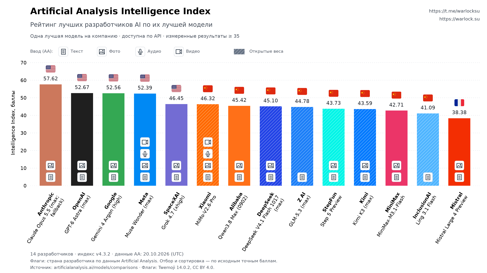

# AI Fair Rating

**Один разработчик — одна лучшая измеренная модель, доступная по API.**

Skill и небольшой Python-скрипт строят понятный рейтинг по [Artificial Analysis Intelligence Index](https://artificialanalysis.ai/evaluations/artificial-analysis-intelligence-index). Режимы и версии одной компании не занимают несколько мест на графике.



Автор: [Telegram](https://t.me/warlocksu) · [warlock.su](https://warlock.su)

## Как выбираются модели

1. Загружается полный публичный каталог [Artificial Analysis](https://artificialanalysis.ai/models/comparisons).
2. Остаются только числовые, независимо измеренные результаты. Предварительные оценки и записи без явного статуса измерения исключаются.
3. У модели должен быть хотя бы один API-провайдер в каталоге AA: **`hostModelCount > 0`**. Ноль исключается; отсутствие поля или неверный формат вызывают понятную ошибку. Доступность не определяется по цене, названию модели или открытым весам.
4. Для всех компаний разрешены любые доступные по API режимы рассуждения, включая **max**. Исключений по разработчику или названию модели нет.
5. По `creator.id` выбирается одна модель с максимальным исходным баллом.
6. На график попадают результаты **от 35 баллов включительно**. Отбор и сортировка выполняются до округления; подписи показывают два знака.

Страны и названия разработчиков берутся из самого источника. Количество компаний меняется с обновлением данных. Это сравнение достижений в одном индексе при указанных настройках; оно не утверждает равный вычислительный бюджет или доступность модели в определённой подписке. Название режима max само по себе не доказывает мультиагентность.

Например, Muse Wonder Full не проходит общий фильтр: AA не указывает у неё API-провайдера, а [Meta подтверждает отсутствие публичного API](https://dev.meta.ai/docs/models). Для Meta выбирается обычная Muse Wonder. Если Full появится в API и получит лучший измеренный балл, она сможет попасть в рейтинг без изменения правил или кода.

Значки внутри столбцов показывают поддерживаемый **ввод выбранной модели** по данным AA: снизу вверх — текст, фото, аудио, видео. Показываются только поддерживаемые типы. Источник — булевы поля `inputModalityText`, `inputModalityImage`, `inputModalitySpeech`, `inputModalityVideo`; отсутствие или неверный формат поля вызывает ошибку. Значки нарисованы векторно в самом скрипте, без дополнительных загрузок и шрифтов.

**Диагональная штриховка** поверх цвета столбца означает открытые веса выбранной модели: `isOpenWeights == true` в данных AA. Признак сохраняется в CSV как `open_weights`; отсутствие или неверный формат исходного поля вызывает ошибку.

## Запуск

Нужен Python 3.10+; API-ключ не требуется.

```bash
git clone https://github.com/MetaWarlock/ai-fair-rating.git
cd ai-fair-rating
python -m venv .venv
```

Активировать окружение:

```powershell
# Windows PowerShell
.venv\Scripts\Activate.ps1
```

```bash
# macOS / Linux
source .venv/bin/activate
```

Установить зависимости и построить свежий рейтинг:

```bash
python -m pip install -r skills/ai-fair-rating/requirements.txt
python skills/ai-fair-rating/scripts/rating.py --output output
```

В `output/` появятся:

| Файл | Содержимое |
| --- | --- |
| `rating.png` | График для публикации |
| `rating.svg` | Масштабируемая версия; контакты кликабельны |
| `rating.csv` | Модели, страны, точные баллы, режимы, число API-провайдеров, типы ввода (`text;image;audio;video`), открытые веса и ссылки |
| `metadata.json` | Дата получения данных, версия индекса, правила и проверка зазора флагов |
| `snapshot.json` | Исходный снимок для воспроизводимого построения |

Повторить построение без обновления данных AA:

```bash
python skills/ai-fair-rating/scripts/rating.py --snapshot output/snapshot.json --output output/replay
```

Дата исходного снимка сохраняется. Новые флаги при необходимости загружаются отдельно; уже используемые флаги входят в skill.

Необязательные параметры:

```bash
python skills/ai-fair-rating/scripts/rating.py --min-score 40 --telegram https://t.me/yourname --website https://example.com
```

## Использование как skill

Скопируйте целиком папку [`skills/ai-fair-rating`](skills/ai-fair-rating) в каталог skills своего AI-агента. В ней уже находятся инструкции, скрипт, зависимости и флаги; остальной репозиторий для работы skill не нужен.

Пример запроса:

> Используй $ai-fair-rating: получи свежие данные, построй рейтинг и покажи картинку.

Контакты автора стоят на графике по умолчанию и меняются параметрами командной строки. Перед публикацией агент проверяет картинку. Сам skill ничего не публикует и не создаёт расписаний.

## Структура

```text
AGENTS.md                 правила работы с проектом
README.md                 запуск и методология
LICENSE                   MIT для кода и инструкций
skills/ai-fair-rating/
  SKILL.md                инструкции агента
  agents/openai.yaml      метаданные skill
  requirements.txt        три зависимости
  scripts/rating.py       получение, отбор и график
  assets/flags/           флаги и их атрибуция
tests/test_rating.py      отбор, декодирование, воспроизводимость и зазор
examples/                 опубликованный пример с датой данных
```

Проверки:

```bash
python -m unittest discover -s tests -v
```

Если формат источника изменится, скрипт завершится с понятной ошибкой. Он не подменяет полный каталог несколькими изначально выбранными моделями и не использует старые данные без явного `--snapshot`.

## Источник и лицензии

Данные и методология: [Artificial Analysis](https://artificialanalysis.ai/methodology/intelligence-benchmarking). Содержимое источника не перелицензируется этим проектом; полный сырой каталог не входит в Git.

Код и инструкции: [MIT](LICENSE). Флаги: Twemoji 14.0.2, [CC BY 4.0](https://creativecommons.org/licenses/by/4.0/), Twitter, Inc. and other contributors; [атрибуция](skills/ai-fair-rating/assets/flags/ATTRIBUTION.md).

AI Fair Rating is a reusable agent skill and CLI for a deduplicated Artificial Analysis developer ranking. Each developer's best measured API model, unrestricted reasoning effort, a minimum score of 35, and reproducible snapshots. The skill instructions are in English; chart labels and this guide are in Russian.
